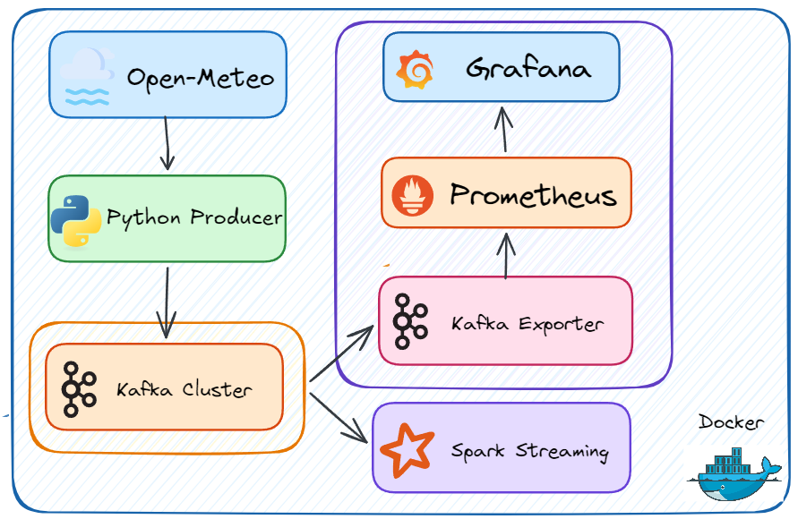

# 🌦️ End-to-End Weather Data Streaming Pipeline

Hệ thống đường ống dữ liệu thời gian thực (Real-time Data Pipeline), có chức năng thu thập dữ liệu thời tiết, luân chuyển qua Message Broker, xử lý phân tích và giám sát hệ thống trực quan.

## 🏗️ Kiến trúc hệ thống (Architecture)

Hệ thống được chia thành 3 phân khu, hoạt động hoàn toàn độc lập và được chứa (containerized) bằng Docker:

1. **Data Acquisition (Thu thập dữ liệu):** Gọi API từ Open-Meteo định kỳ và đẩy vào hệ thống.
2. **Event Bus (Luân chuyển sự kiện):** Apache Kafka đóng vai trò trung tâm phân phối thông điệp.
3. **Downstream Consumers (Xử lý & Giám sát):** 
   - **Spark Streaming** tiêu thụ dữ liệu từ Kafka để tính toán nhiệt độ trung bình.
   - **Kafka Exporter + Prometheus + Grafana** giám sát toàn bộ đường ống (độ trễ, tốc độ xử lý).



## 🛠️ Công nghệ sử dụng (Tech Stack)

- **Ngôn ngữ:** Python 3.11
- **Message Broker:** Apache Kafka & Zookeeper
- **Xử lý dữ liệu (Stream Processing):** Apache Spark (PySpark Structured Streaming)
- **Giám sát (Observability):** Prometheus, Grafana, Kafka Exporter
- **Triển khai (Deployment):** Docker & Docker Compose

## 🚀 Hướng dẫn cài đặt và chạy dự án (Getting Started)

### Yêu cầu hệ thống (Prerequisites)
- Đã cài đặt [Docker](https://docs.docker.com/get-docker/) và Docker Compose.
- Terminal chạy nền tảng Bash (Linux, macOS, hoặc Git Bash/WSL trên Windows).

### Khởi chạy tự động

**Bước 1:** Cấp quyền thực thi cho tệp script:
```bash
chmod +x run_pipeline.sh
```

**Bước 2:** Chạy đường ống dữ liệu:
```bash
./run_pipeline.sh
```

### Tạm dừng hoặc Dừng hẳn hệ thống

- **Tạm dừng:**
  ```bash
  docker compose stop
  ```
- **Xóa toàn bộ (Clean up):**
Lần tới khi chạy lại `./run_pipeline.sh`, hệ thống sẽ tự động dọn dẹp các tiến trình bị lỗi và rác Checkpoint cũ.

## 📊 Bảng điều khiển giám sát (Dashboards)

Sau khi hệ thống khởi chạy thành công, truy cập các địa chỉ sau trên trình duyệt:

- **Grafana (Monitoring Dashboard):** [http://localhost:3000](http://localhost:3000)
- **Prometheus (Time-series DB):** [http://localhost:9090](http://localhost:9090)
- **Kafka Exporter (Raw Metrics):** [http://localhost:9308/metrics](http://localhost:9308/metrics)

Đảm bảo ở góc phải trên cùng của Grafana, bạn chọn bộ lọc thời gian là **Last 5 minutes** để thấy dữ liệu cập nhật theo thời gian thực (Consumer Lag, Messages/sec).